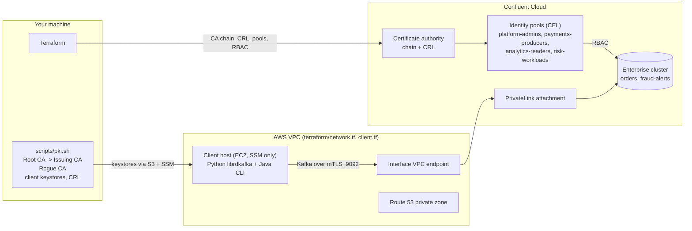

# Confluent Cloud mTLS Demo

End-to-end, reusable demo of [mutual TLS (mTLS) authentication on Confluent Cloud](https://docs.confluent.io/cloud/current/security/authenticate/workload-identities/identity-providers/mtls/overview.html)
on an **Enterprise cluster over AWS PrivateLink**. Kafka clients authenticate with X.509
certificates from **your own private CA**, and **certificate identity pools** with
**CEL filters** map certificate attributes to RBAC permissions. There are no API keys
anywhere in the data path: even the topics are created by a certificate identity.

| # | Scenario | Certificate | Outcome |
|---|----------|-------------|---------|
| 0 | Platform team creates topics | `OU=platform` | allowed |
| 1 | Producer writes `orders` | `OU=payments` | allowed |
| 2 | Consumer reads `orders` | `OU=analytics` | allowed |
| 3 | Least privilege: consumer tries to write | `OU=analytics` | `TOPIC_AUTHORIZATION_FAILED` |
| 4 | Least privilege: consumer uses someone else's group | `OU=analytics` | `GROUP_AUTHORIZATION_FAILED` |
| 5 | Workload identity from a SPIFFE URI SAN | `URI:spiffe://acme.demo/ns/risk/...` | allowed |
| 6 | Trusted CA, but no pool matches | `OU=marketing` | rejected |
| 7 | Imposter: same subject DN, untrusted CA | rogue `Acme Root CA` | rejected |
| 8 | Revocation via CRL (`make revoke`) | `CN=legacy-producer` | allowed, then rejected (about 45s after the CRL upload in testing) |

## Architecture



**How mTLS on Confluent Cloud works:**

1. **Certificate authority** (`confluent_certificate_authority`): upload the PEM chain of

   the CA that signs client certs (issuing CA first, max 4 certs) and optionally a CRL.
    It is **organization-wide**: every mTLS-capable cluster in the org trusts it.
    Existing API key and OAuth authentication keep working.
2. **Certificate identity pools** (`confluent_certificate_pool`): a CEL filter over

   certificate fields (`CN`, `O`, `OU`, `DN`, `SAN`, `SNID`, `SHA1`, ...). The client does
    **not** name a pool: every pool whose filter matches applies, and permissions are the
    **union**. `external_identifier` (here `CN`) is what shows up in audit logs.
3. **RBAC** (`confluent_role_binding`): the pool is the principal (`User:pool-xxxx`).
4. **Client**: plain `security.protocol=SSL` with a keystore. Brokers present Let's Encrypt

   server certificates, so the standard public trust store is all the client needs.

**Why a client host?** Enterprise clusters only have private endpoints, so clients have
to run inside a VPC connected through PrivateLink. The EC2 instance has no SSH key and no
inbound rules; you reach it through SSM. `scripts/remote.sh` pushes the client keystores
to it through a private S3 bucket. **CA private keys never leave your machine**, and
revocation happens locally.

## Requirements

- Confluent Cloud **Cloud API key** for a principal with **OrganizationAdmin**
(certificate authorities are org-level resources).
- AWS credentials allowed to create VPC, EC2, IAM role/instance profile, S3, Route 53 and
VPC endpoint resources.
- Terraform >= 1.5, AWS CLI v2, jq, OpenSSL 3 (`brew install openssl@3`; macOS ships
LibreSSL), and for interactive sessions the
[Session Manager plugin](https://docs.aws.amazon.com/systems-manager/latest/userguide/session-manager-working-with-install-plugin.html)
(`brew install --cask session-manager-plugin`).

> **Cost:** the Enterprise cluster (billed by eCKU-hour), the PrivateLink endpoint and a
> `t3.small` instance are billed while they exist. Run `make down` when you are done.

## Quick start

```bash
cp .env.example .env                                              # Confluent Cloud API key, AWS_PROFILE
cp terraform/terraform.tfvars.example terraform/terraform.tfvars  # owner, keep_until, region, aws_tags

make setup        # check tools and credentials
make up           # generate PKI, terraform apply, wait for the client host
make demo         # guided walkthrough, scenarios 0 to 7 (interactive)
make revoke       # scenario 8: CRL revocation
make down         # destroy everything (Confluent Cloud and AWS)
make clean        # delete local certs and demo state
```

`make demo-batch` runs the same walkthrough without the Session Manager plugin and prints the
output at the end. `make help` lists every target.

## Repository layout

```
pki/
  openssl.cnf              CA and client certificate profiles (clientAuth EKU, digitalSignature KU)
  identities.txt           demo identities: name | issuing CA | subject DN | SAN
  out/                     generated, gitignored: CAs, ca-chain.pem, crl-chain.pem, clients/<name>/keystore.p12
terraform/
  main.tf                  environment, Enterprise cluster, PrivateLink attachment + connection
  network.tf               VPC, subnets, VPC endpoint, Route 53 private zone
  client.tf                client host (EC2 + SSM), bundle bucket, IAM
  mtls.tf                  certificate authority, identity pools (CEL), role bindings
clients/
  mtls_client.py           librdkafka (confluent-kafka) client: create-topics, produce, consume, list-topics
  java-cli.sh              Kafka Java CLI tools with the documented client.properties
scripts/
  pki.sh                   init | issue | revoke | crl | show | clean
  remote.sh                wait | sync | run | exec | tty | shell on the client host
  demo.sh                  guided scenarios with expected outcomes (runs on the client host)
  revoke-demo.sh           CRL revocation walkthrough
```

## Running clients by hand

### Connecting to the client host

The client host has no SSH key and no inbound ports; you connect with SSM Session Manager.

```bash
brew install --cask session-manager-plugin   # one time
make shell                                   # root shell in /opt/mtls-demo
```

Alternatives:

- AWS CLI: `aws ssm start-session --target <client_instance_id> --region <region>`, then
  `sudo -i` and `cd /opt/mtls-demo` (`make outputs` shows the instance ID).
- AWS console: EC2, select `<name>-client`, **Connect**, **Session Manager** tab, **Connect**,
  then `sudo -i` and `cd /opt/mtls-demo`.
- One-off command from your machine, no session: `scripts/remote.sh run '<command>'`.

If your AWS SSO session has expired, log in again first (for example `granted sso login`).

### Python client (librdkafka)

```bash
.venv/bin/python clients/mtls_client.py --identity orders-producer produce --topic orders --count 5
.venv/bin/python clients/mtls_client.py --identity analytics-consumer consume --topic orders --group analytics-bi
.venv/bin/python clients/mtls_client.py --identity fraud-detector list-topics
```

### Plain Kafka CLI tools

The Apache Kafka CLI (Java 21) is installed at `/opt/kafka/bin`. Set up your shell and
write one `client.properties` per identity:

```bash
cd /opt/mtls-demo
export PATH=/opt/kafka/bin:$PATH
export BS=$(cat .demo/bootstrap)

for id in orders-producer analytics-consumer fraud-detector platform-admin marketing-app; do
  pw=$(cat pki/out/clients/$id/keystore.password)
  cat > /tmp/$id.properties <<EOF
security.protocol=SSL
ssl.keystore.location=/opt/mtls-demo/pki/out/clients/$id/keystore.p12
ssl.keystore.type=PKCS12
ssl.keystore.password=$pw
ssl.key.password=$pw
EOF
done
```

No API keys and no truststore: the certificate is the credential, and the JVM already
trusts the brokers' Let's Encrypt certificates. Then use the tools as usual:

```bash
# List topics (each identity only sees topics it has access to)
kafka-topics.sh --bootstrap-server $BS --command-config /tmp/platform-admin.properties --list

# Produce as the payments service
kafka-console-producer.sh --bootstrap-server $BS --producer.config /tmp/orders-producer.properties --topic orders

# Consume as analytics (group must match analytics-*)
kafka-console-consumer.sh --bootstrap-server $BS --consumer.config /tmp/analytics-consumer.properties \
  --topic orders --group analytics-cli --from-beginning

# Create a topic (only platform-admin has DeveloperManage)
kafka-topics.sh --bootstrap-server $BS --command-config /tmp/platform-admin.properties \
  --create --topic payments-audit --partitions 3
```

Things worth trying live:

| Try | Expected |
|-----|----------|
| Produce with `/tmp/analytics-consumer.properties` | `TopicAuthorizationException` (least privilege) |
| Consume as analytics with `--group foo` | `GroupAuthorizationException` |
| Anything with `/tmp/marketing-app.properties` | hangs, then times out: trusted CA, but no identity pool matches |

Kafka 4.x may print a deprecation warning for `--producer.config` / `--consumer.config`;
they still work.

Shortcut: `clients/java-cli.sh <identity> <tool> [args]` writes the properties file and
adds `--bootstrap-server` for you, for example `clients/java-cli.sh orders-producer kafka-topics --list`.

Java client configuration (`client.properties`):

```properties
security.protocol=SSL
ssl.keystore.location=/path/to/keystore.p12
ssl.keystore.type=PKCS12
ssl.keystore.password=<password>
ssl.key.password=<password>
```

librdkafka clients (Python, Go, .NET, C/C++) use the same `security.protocol=SSL`,
`ssl.keystore.location` and `ssl.keystore.password`, plus `ssl.ca.location` pointing at a
public CA bundle if the platform has no default one (the Python client uses `certifi`).

## Adding your own identity

1. Add a line to `pki/identities.txt`, for example

   `inventory-svc | trusted | /C=US/O=Acme Corp/OU=inventory/CN=inventory-svc | DNS:inventory.acme.demo`
2. `scripts/pki.sh issue inventory-svc`
3. Add a pool to `local.pools` in `terraform/mtls.tf` with a CEL filter and role bindings,

   then `make up`. The next `scripts/remote.sh run|sync` pushes the new keystore.

CEL filter cheat sheet ([full reference](https://docs.confluent.io/cloud/current/security/authenticate/workload-identities/identity-providers/mtls/cel-filters.html)):

```text
CN == "orders-producer"
O == "Acme Corp" && OU in ["payments", "billing"]
CN.startsWith("prod-")
DN.contains("OU=payments")
SAN.contains("URI:spiffe://acme.demo/ns/risk/")
SAN.contains("DNS:*.acme.demo")
SNID == "00D3B9E2C1CC02971E"
```

## Troubleshooting

| Symptom | Likely cause |
|---------|--------------|
| Client times out on connect | No pool matches the cert, the CA is not uploaded, or the CA cert expired. Confluent Cloud does not return a reason. Also check DNS/PrivateLink: `getent hosts <bootstrap host>` on the client host should return VPC IPs. |
| SSL handshake error | Client cert expired, missing `clientAuth` EKU / `digitalSignature` KU, or (librdkafka) the issuing CA is missing from the uploaded chain. |
| `SslAuthenticationException ... certificate_revoked` | Cert is on the CRL. Enterprise clusters always enforce CRLs fail-closed. |
| `*_AUTHORIZATION_FAILED` | Authenticated fine; the matching pool(s) lack a role binding for that topic or group. |
| librdkafka fails after the CA is added | The client sets `SASL_SSL` together with `ssl.certificate.location`/`ssl.key.location`. Use one auth method. |
| `make up` stuck waiting for the client host | Check `/var/log/cloud-init-output.log` via `make shell` (or `scripts/remote.sh exec 'tail /var/log/cloud-init-output.log'`). The Kafka CLI comes from the Apache CDN, which only carries current releases; if `kafka_cli_version` is no longer there, the fallback archive.apache.org is very slow. |
| VPC quota reached | Set `existing_vpc_id` and `existing_subnet_ids` to reuse a VPC (DNS hostnames on, first subnet with internet access). |

Inspect what was created:

```bash
make outputs
confluent iam certificate-authority list
confluent iam certificate-pool list --provider <op-xxxx>
scripts/pki.sh show orders-producer
```

## Notes and limits

- Supported cluster types: Dedicated (all clouds), AWS/Azure Enterprise, AWS Freight.
- mTLS covers the Kafka protocol only. Schema Registry, ksqlDB, Flink and the Kafka REST
APIs are not supported with mTLS, which is also why topics are created over Kafka here.
- Public CAs are not supported; use a private CA.
- The uploaded CRL must be issued by the configured CA (direct CRLs). CRLs and client
certificates generated here are valid for 30 days; refresh with `scripts/pki.sh crl` /
`scripts/pki.sh issue <name>` and `make up`.
- Confluent Cloud resources do not support tags, so `owner` and `keep_until` go into
resource descriptions. AWS resources get `aws_tags` through provider `default_tags`
(and explicitly on the EC2 root volume).

## References

- [mTLS overview](https://docs.confluent.io/cloud/current/security/authenticate/workload-identities/identity-providers/mtls/overview.html)
- [Configure mTLS](https://docs.confluent.io/cloud/current/security/authenticate/workload-identities/identity-providers/mtls/configure.html)
- [Certificate identity pools](https://docs.confluent.io/cloud/current/security/authenticate/workload-identities/identity-providers/mtls/identity-pool.html)
- [CEL filters](https://docs.confluent.io/cloud/current/security/authenticate/workload-identities/identity-providers/mtls/cel-filters.html)
- [Troubleshooting](https://docs.confluent.io/cloud/current/security/authenticate/workload-identities/identity-providers/mtls/troubleshoot.html)
- Terraform: [`confluent_certificate_authority`](https://registry.terraform.io/providers/confluentinc/confluent/latest/docs/resources/confluent_certificate_authority), [`confluent_certificate_pool`](https://registry.terraform.io/providers/confluentinc/confluent/latest/docs/resources/confluent_certificate_pool), [Enterprise + PrivateLink attachment example](https://github.com/confluentinc/terraform-provider-confluent/tree/master/examples/configurations/enterprise-privatelinkattachment-aws-kafka-acls)
